# HomeNet IoT Switch

ESP32로 만든 **3구 스마트 전등 스위치**와 기기 등록을 받는 **Flask 서버**입니다.
스마트폰으로 스위치의 임시 Wi-Fi(AP)에 접속해 집 공유기 정보와 계정을 입력하면, 스위치가 공유기에 붙은 뒤 서버에 자기 자신을 등록합니다.

> 2020년 1학기 홈네트워크 수업 팀 프로젝트(1조)입니다. 학교 GitLab에서 진행한 작업을 정리해 옮겼습니다.

## 맡은 역할

| 담당 | 내용 |
|---|---|
| **본인** | ESP32 펌웨어 전체 (AP 프로비저닝, Wi-Fi 스캔 페이지, 기기 등록, 릴레이/버튼/LED 제어), 서버 인증·DB 스키마·기기 등록 API |
| 팀원 | 로그인/회원가입 화면 초안, 게시판 기능 (최종본에서는 제외) |

## 동작 흐름

```
 [스위치 등록 버튼]
        │
        ▼
 ESP32가 AP 모드로 전환 ("switchAP")
        │  스마트폰으로 접속 → 192.168.4.1
        ▼
 주변 Wi-Fi 스캔 결과가 담긴 등록 페이지 표시
 (사이트 아이디/비밀번호 + 공유기 SSID/비밀번호 입력)
        │
        ▼
 AP 종료 → 집 공유기에 접속
        │
        ▼
 POST /auth/registerSwitch  (username, password, mac, type)
        │
        ▼
 Flask 서버: 계정 확인 → switch 테이블에 MAC 등록 (같은 MAC이면 갱신)
```

## 시연 영상

[](https://youtu.be/p2JOymDVLDY)

▶ 이미지를 누르면 YouTube에서 재생됩니다.

## 화면

### 1. 스위치 기기 등록 (ESP32 AP 웹페이지)
스위치의 등록 버튼을 누르면 ESP32가 `switchAP` Wi-Fi를 엽니다. 스마트폰으로 접속하면 주변 공유기 목록이 담긴 등록 페이지가 뜨고, 완료하면 스위치가 공유기에 붙어 서버에 자신을 등록합니다.

| 등록 페이지 | 제출 후 안내 |
|:---:|:---:|
| 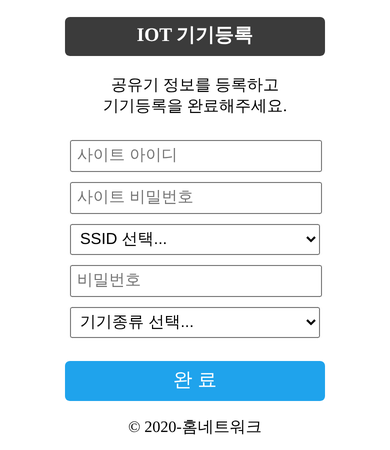 | 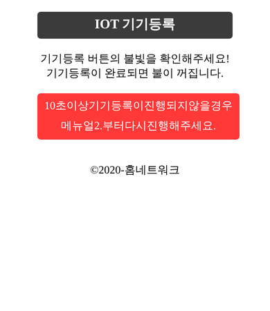 |

### 2. 웹 (Flask)

| 로그인 | 회원가입 |
|:---:|:---:|
| 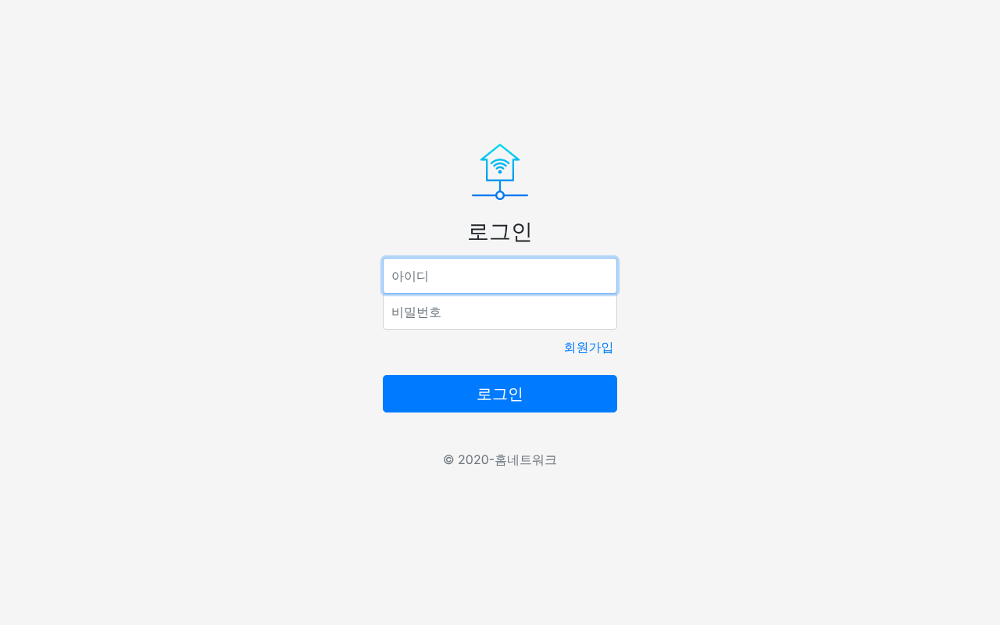 | 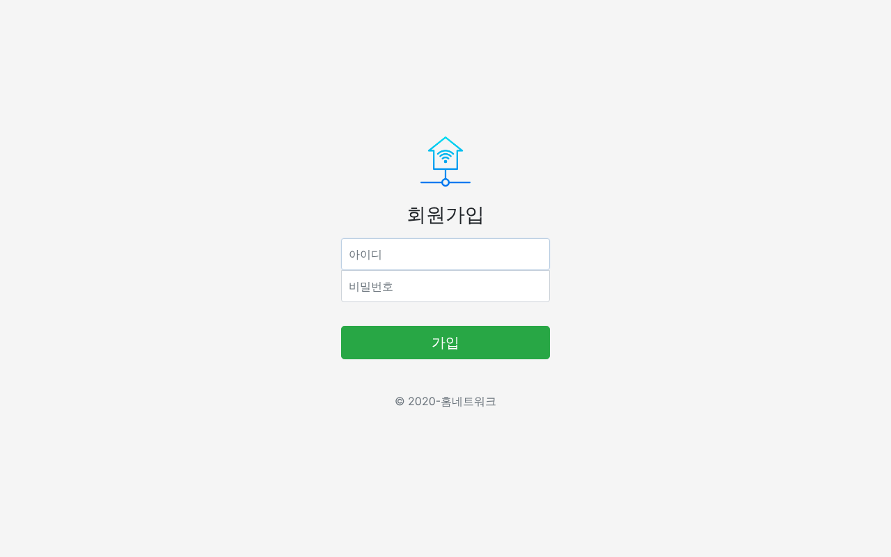 |

**IOT 제어 페이지**: 내 계정에 등록된 스위치가 MAC 주소별로 표시되고, 버튼을 누르면 MQTT로 해당 채널 제어 메시지가 발행됩니다.

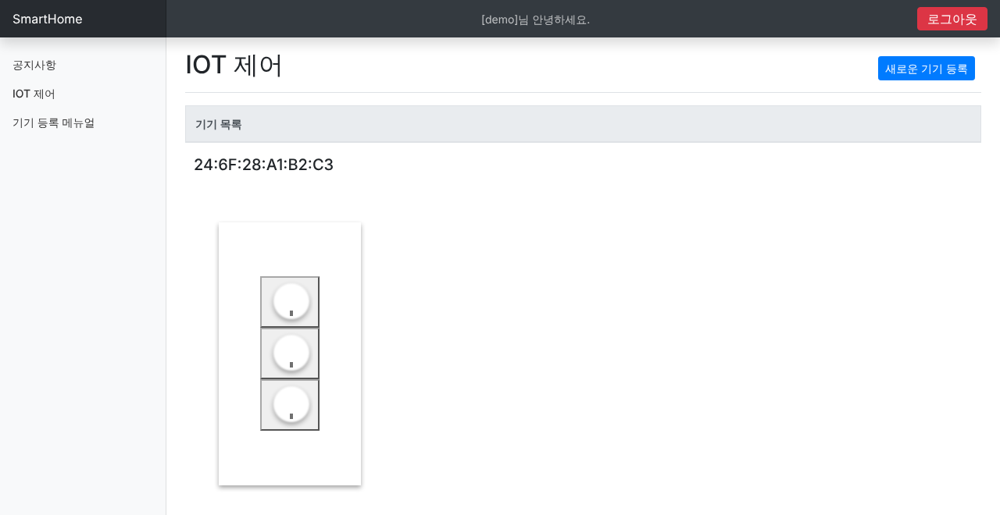

### 3. PC 클라이언트 (Java Swing)

| 로그인 | 스위치 제어 |
|:---:|:---:|
| 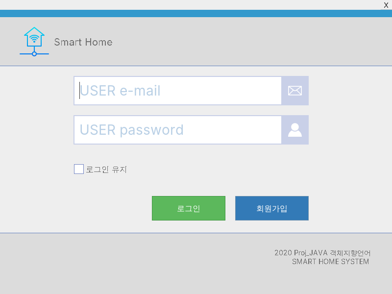 | 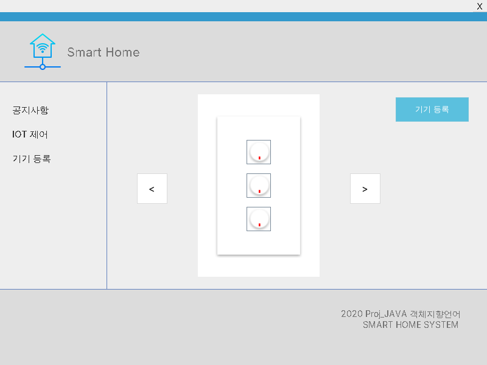 |

> 화면은 저장소의 코드를 그대로 실행해 캡처했습니다. 공유기 목록과 MAC 주소는 예시 값입니다.

## 폴더 구조

```
firmware/
  iot_switch/            최종 펌웨어 (릴레이 3채널 + 등록 버튼)
  ard_ap_server_test/    AP 모드 + 웹 폼 테스트
  wifi_access_test/      공유기 접속 테스트
  http_post_test/        서버 POST 테스트
  device_regist_test/    AP 프로비저닝 → 등록까지 통합 테스트
  device_regist_btn_test/ 등록 버튼 트리거 테스트
pc-client/              PC 제어 프로그램 (Java Swing + MQTT)
docs/images/            README 화면 캡처, build/ 제작 과정 사진
server/
  flaskr/                Flask 앱 (auth: 회원·기기 등록 / main: 웹 제어 페이지·MQTT 발행, SQLite)
  run.bat
```

## PC 클라이언트 (pc-client)

Java Swing으로 만든 데스크탑 제어 프로그램입니다.

1. 로그인 화면에서 아이디/비밀번호 입력 → `POST /auth/loginJava`
2. 로그인 성공 시 `POST /java`로 내 스위치의 MAC 주소를 받아옴
3. 제어 화면의 스위치 버튼 3개를 누르면 MQTT 브로커로 `mac=…&btnNum=1~3` 발행

```
src/
  general/Main.java          시작점 (로그인 창)
  control/                   서버 통신(HTTP POST), MQTT 발행, 서버 주소 설정(Config)
  view/swing/screens/        로그인·메인(스위치 제어) 화면
  view/swing/custom, other/  테두리 없는 창, 커스텀 버튼·입력칸 등 UI 부품
```

실행 (JDK 8 이상, [Eclipse Paho MQTT 1.2.4](https://repo1.maven.org/maven2/org/eclipse/paho/org.eclipse.paho.client.mqttv3/1.2.4/) jar를 `pc-client/lib`에 넣기)
```bash
cd pc-client
javac -encoding UTF-8 -cp lib/* -d out $(find src -name "*.java") && cp -r src/view/images out/view/
java -cp "out;lib/*" -Dserver.url=http://서버주소:5000 -Dmqtt.broker=tcp://브로커주소:1883 general.Main
```

> UI 부품 중 일부(`RectlookTextField`, `RectlookCheckBoxIcon`, `CustomImageIcon`, `AlterFonts`)는 공개된 Swing 템플릿을 가져와 수정해 썼습니다.

## 하드웨어

- ESP32 개발보드
- 릴레이 3채널 (GPIO 5, 17, 16)
- 버튼 4개: 등록 버튼 1 + 전등 버튼 3 (GPIO 3, 23, 22, 1)
- 상태 LED 4개 (GPIO 13, 21, 19, 18)

### 제작 과정 (2020년 6월)

시중 벽 스위치 프레임 안에 만능기판·ESP32·릴레이를 직접 배치하고 납땜해 3구 스위치로 만들었습니다.

| | | |
|:---:|:---:|:---:|
| 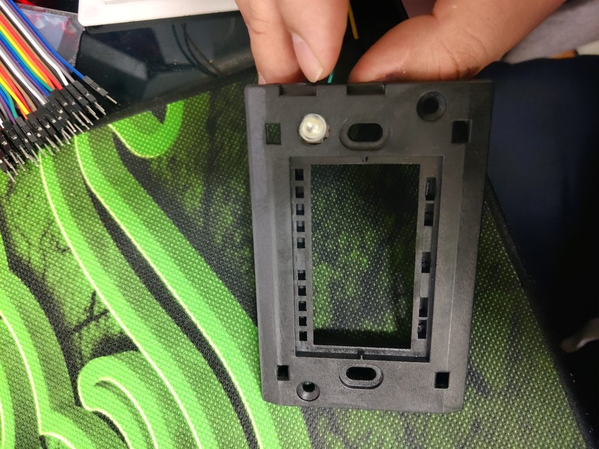<br>스위치 프레임 분해 | 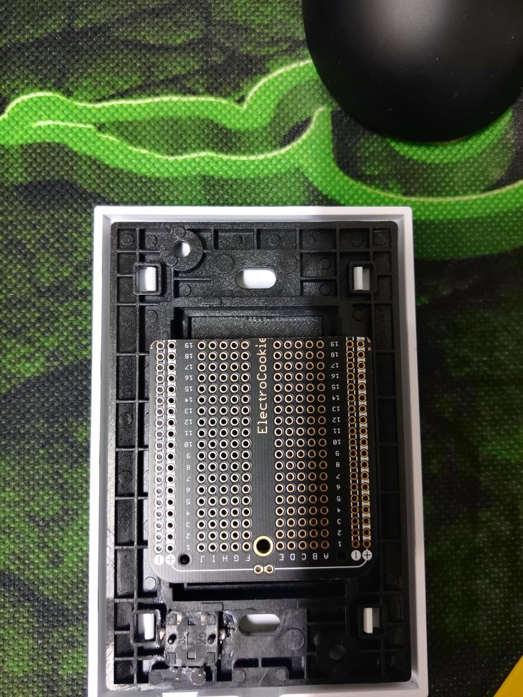<br>프레임에 맞춘 만능기판 | 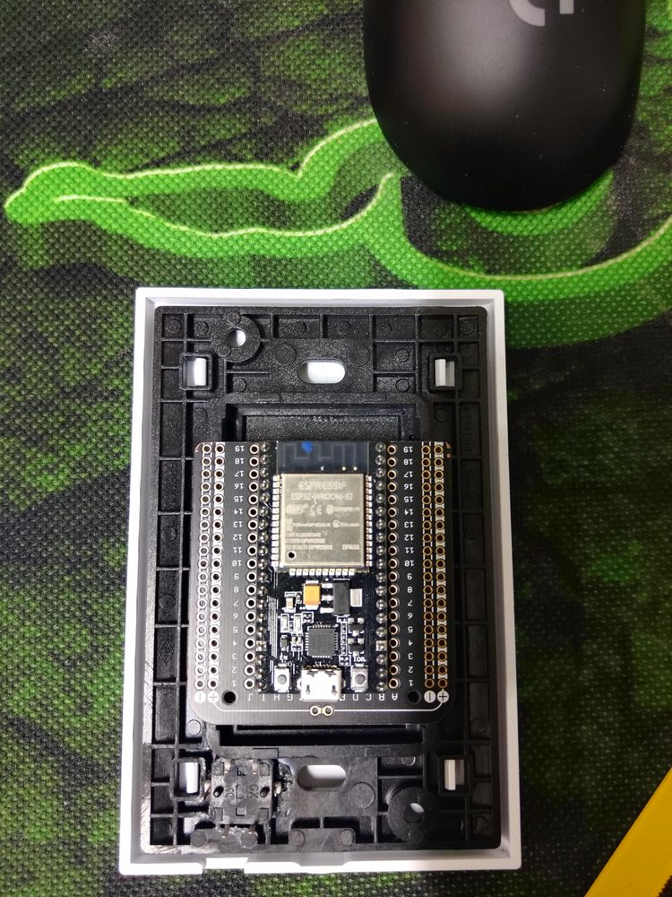<br>ESP32 장착 |
| 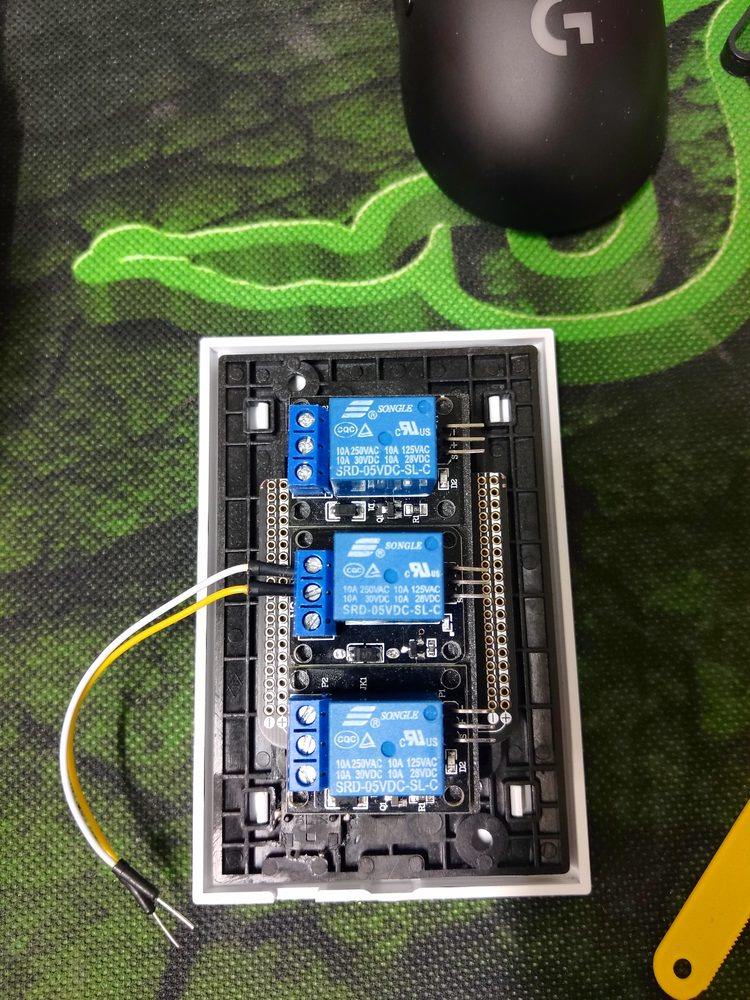<br>릴레이 3채널 배치 | 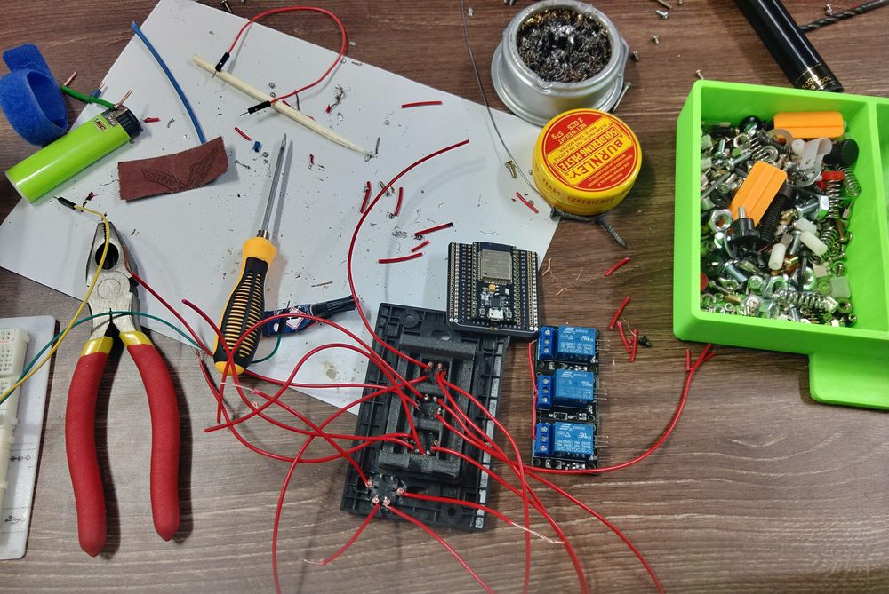<br>배선·납땜 | 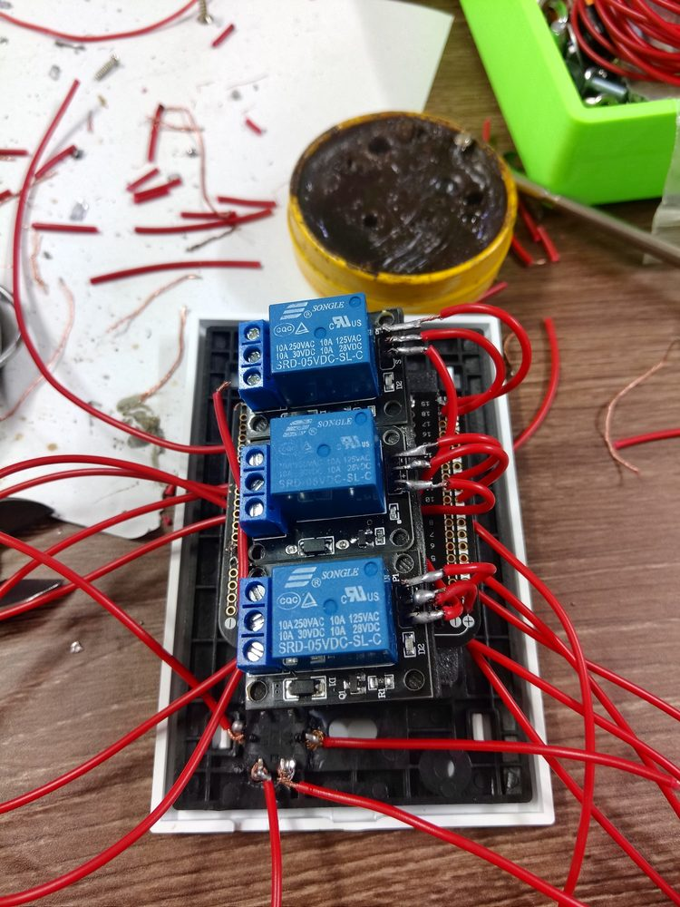<br>프레임 안 배선 |
| 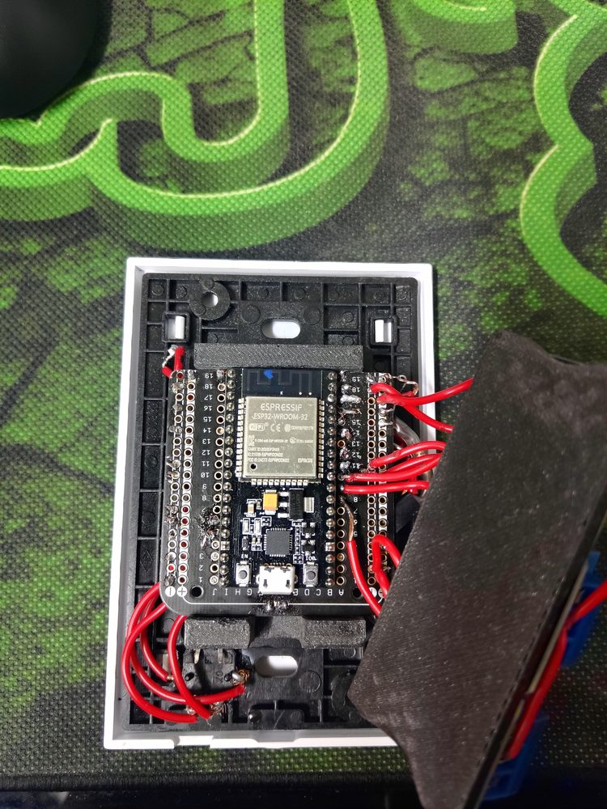<br>내부 조립 | 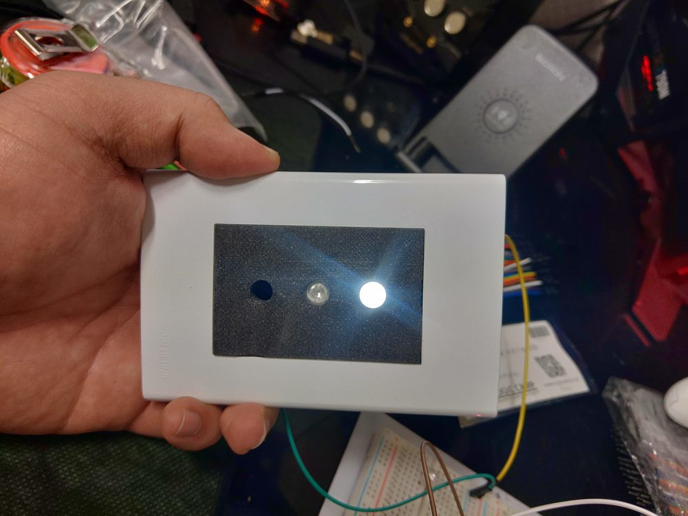<br>버튼 LED 점등 테스트 | 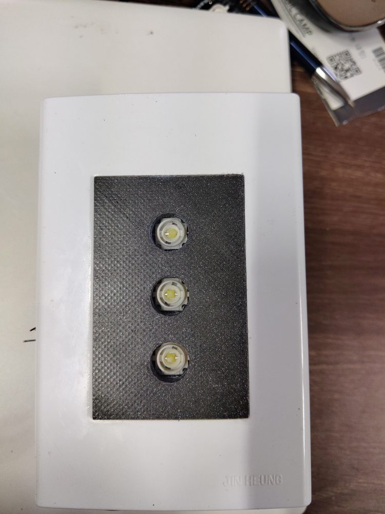<br>완성 (3구 + 상태 LED) |

## 서버 API

| 메서드 | 경로 | 파라미터 | 설명 |
|---|---|---|---|
| POST | `/auth/register` | username, password | 회원가입 (비밀번호는 werkzeug 해시 저장) |
| POST | `/auth/login` | username, password | 로그인 (세션) |
| POST | `/auth/registerSwitch` | username, password, mac, type | 스위치 기기 등록 |
| POST | `/auth/registerMoodLight` | username, password, mac, r1 | 무드등 기기 등록 |
| POST | `/auth/loginJava` | username, password | PC 클라이언트용 로그인 (성공 시 `ok`) |
| POST | `/java` | username | 사용자의 스위치 MAC 주소 반환 (PC 클라이언트용) |
| GET | `/control` | mac, btnNum | 웹 제어 페이지. 버튼을 누르면 MQTT `topic`으로 `mac=…&btnNum=1~3` 발행 |

DB는 SQLite이며 `user`, `switch`(채널별 on/off 상태 r1~r3), `moodLight` 테이블을 씁니다. (`server/flaskr/schema.sql`)

## 실행

**서버**
```bash
cd server
pip install flask flask-mqtt
set MQTT_BROKER_URL=브로커 주소   # 기본값 127.0.0.1 (MQTT_BROKER_PORT, MQTT_USERNAME, MQTT_PASSWORD도 설정 가능)
set FLASK_APP=flaskr
flask init-db        # 최초 1회
flask run --host=0.0.0.0
```

**펌웨어** (Arduino IDE, ESP32 보드 매니저)
- 라이브러리: `ESPAsyncWebServer`, `AsyncTCP`
- 펌웨어 안의 `YOUR_SERVER_IP`, `YOUR_AP_PASSWORD`, 테스트 스케치의 `YOUR_WIFI_SSID`/`YOUR_WIFI_PASSWORD`를 본인 환경에 맞게 바꿔서 업로드하세요.

## 알려진 한계 (당시 그대로 보존)

- 학기 중 MQTT로 원격 제어까지 붙이려 했으나 완성하지 못해 `iot_switch.ino`의 MQTT 부분과 `sendRlyCon()`이 비어 있습니다. 이 부분은 이후 프로젝트 [lithophane-moodlight](https://github.com/jwj-98/lithophane-moodlight)에서 MQTT 구독으로 구현했습니다.
- `registerMoodLight`가 `moodLight`가 아닌 `user` 테이블에 INSERT 합니다.
- 웹 제어 페이지는 버튼을 누를 때마다 MQTT 메시지만 보내고, 스위치의 실제 on/off 상태(r1~r3)를 화면에 반영하지는 않습니다.
- `main.py`가 MQTT용으로 별도 Flask 앱 객체를 만들어 씁니다. `/java`는 등록된 스위치가 없으면 오류가 납니다.
- 공지사항·매뉴얼 페이지는 빈 템플릿이며, 매뉴얼 경로의 템플릿 이름에 공백 오타(`main/ manual.html`)가 있습니다.
- `SECRET_KEY='dev'`는 Flask 튜토리얼 기본값입니다. 실제 배포 시에는 `instance/config.py`로 분리해야 합니다.
- 서버와 기기 사이 통신이 HTTP 평문입니다.

## 기술 스택

ESP32 (Arduino) · ESPAsyncWebServer · Python Flask · Flask-MQTT · Java Swing · Eclipse Paho · SQLite · Bootstrap
